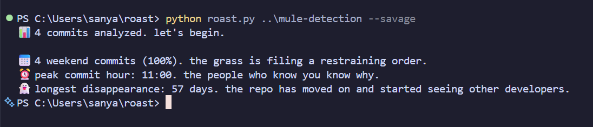

# touchgrass 🌱

reads your git history and roasts you for it.



## usage

You only need Python 3 and git. No dependencies, nothing to install.

```bash
python roast.py                  # roast the repo you're in
python roast.py path/to/repo     # roast any local repo
python roast.py --savage         # same thing, but meaner
```

## what it roasts

- late-night commits (12am to 5am)
- lazy commit messages like "fix" and "update"
- tiny commit messages
- weekend commits
- repeated messages
- long disappearances

## ideas for later

- `--author` filter for roasting one person in a shared repo
- more roasts
- `pip install` support

Built because my GitHub said 88% HTML and I had to do something about it. 😭